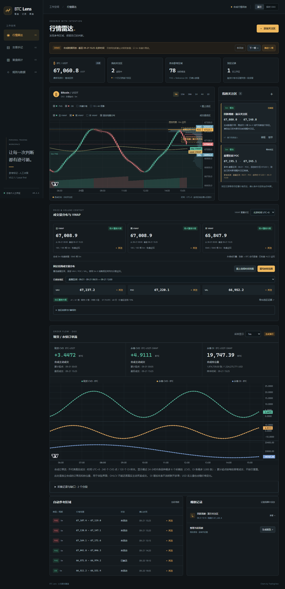
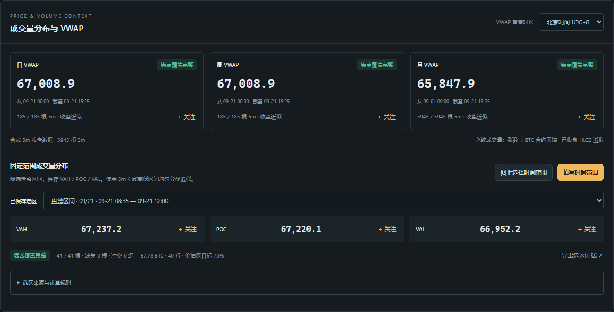
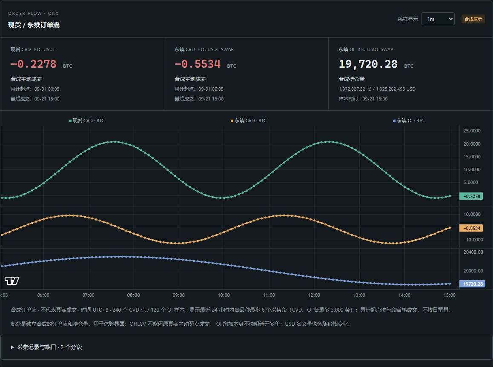
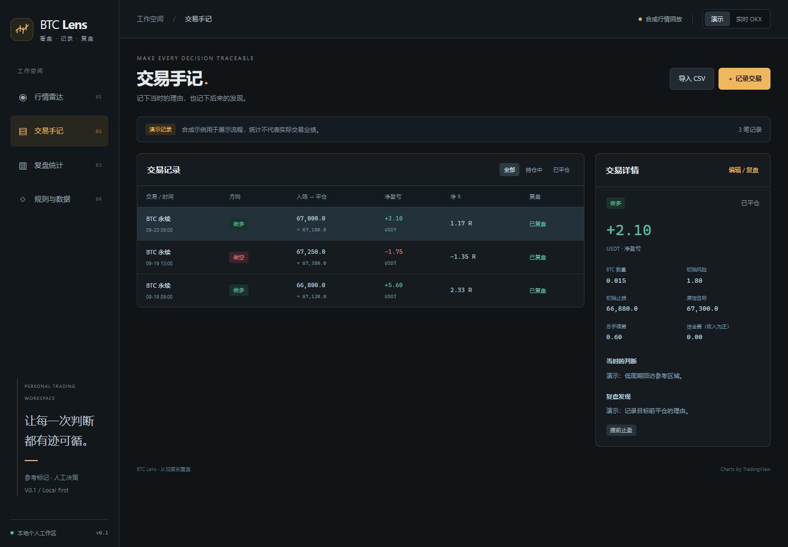
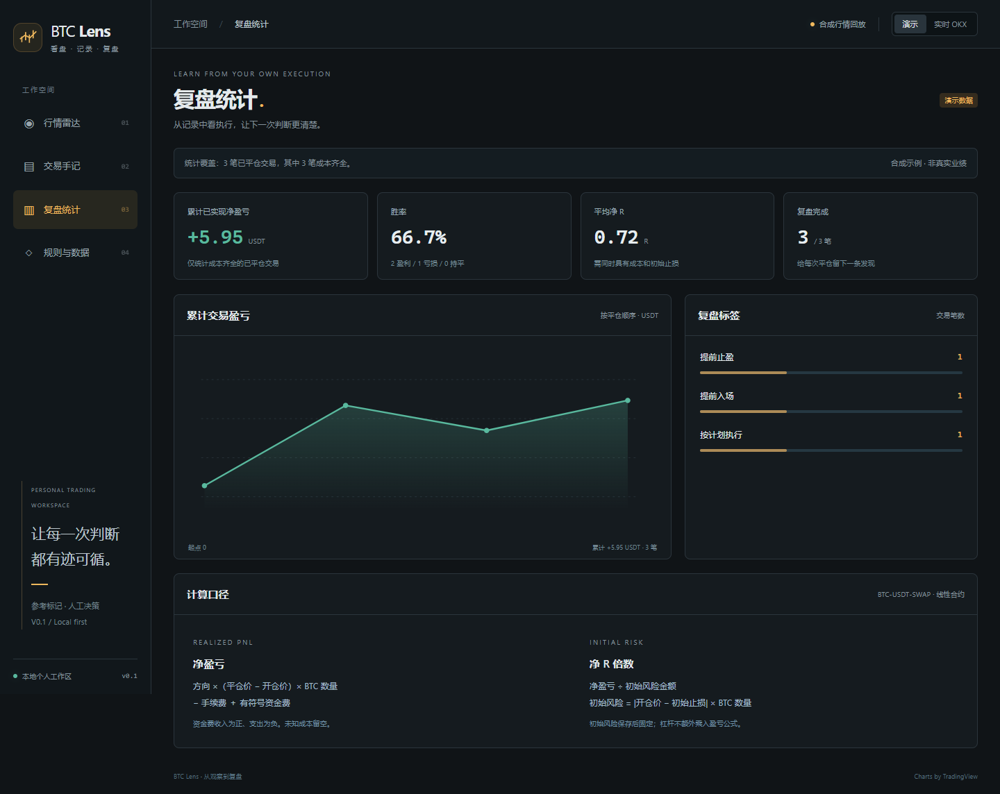

# BTC Lens

**一个从个人交易习惯出发的 BTC 盯盘与交易复盘工作区。**

BTC Lens combines a BTC market radar, chart drawings, user-selected watch zones, evidence snapshots and a trade journal. Built with .NET 10 and Blazor, it runs locally with public OKX market data.

**当前 V0.3.1**：日常操作简化为图上选关注位置、查看行情分析、记录交易与复盘。移除独立规则填写页面，后台采用默认参考参数；千问 AI 引用说明直接展开，价格区域可定位到图上。主图向左拖动或点击按钮可分页加载更早 K 线，复用本地缓存并保持实时更新。订单流保留 OKX 单市场 CVD、聚合现货 / 合约 CVD 和 OI 四个窗格。

[历史 V0.1 录屏：约 3 分钟（带字幕，无配音）](docs/demo.webm)

[历史 V0.2.1 选区与 VWAP 录屏](docs/price-context-demo.webm) · [计算规则与数据覆盖说明](docs/PRICE_CONTEXT.md) · [当前图表操作](docs/CHART_WORKSPACE.md)

## 快速开始

已在 Windows / .NET SDK 10.0.401 上验证。首次启动需要联网还原 NuGet 包；实时行情需要网络，无需账户密钥或大模型 API。

在仓库根目录运行：

~~~powershell
dotnet restore
dotnet run --project src/BtcLens.Web
~~~

打开 **http://127.0.0.1:5080**。自动连接 OKX 实时公共行情，不再提供演示模式入口。

可选：在 [Coinalyze 账户](https://coinalyze.net/account/api-key/) 领取免费 Key，在本地 `/settings` 验证并保存。Key 通过服务端请求头发送，加密保存在本机，不回显、不导出到报告。也支持本机 `Coinalyze__ApiKey` 环境配置。已配置但数据不可用时，行情解读明确暂停订单流确认，不悄悄替换来源。

AI 解释可在同一页配置 [千问 AI 平台](https://platform.qianwenai.com/docs/developer-guides/getting-started/introduction) Key。默认模型 `qwen3.8-max`，也可选择 `qwen3.8-max-0902`、`deepseek-v4-pro-0813`、`qwen3.5-omni-plus`。只在点击解释按钮时请求模型，输入限于当前行情、参考证据和个人规则，不上传交易手记。环境配置为 `Qianwen__ApiKey`。

也可以运行：

~~~powershell
.\tools\Start-BtcLens.ps1
~~~

自动接入 BTC-USDT-SWAP 公共行情。WebSocket 不可用时，程序尝试 REST 轮询，并显示来源。公共行情失败时，保留上次数据与时间。

订单流独立采集 OKX 公共 `trades` 与 Binance 公共 `aggTrade`，覆盖各自 BTC/USDT 现货和永续；OI 每 10 秒通过 REST 采样。价格的 REST 兜底不替代缺失成交。首次接入后从收到的首笔成交起累计，曲线需要时间积累。

## 已实现的闭环

1. **观察行情**：1D、4H、1H、30m、15m、5m 图表；已确认的基础 FVG、参考 OB；前日/前周高低及当日开盘。
2. **图上操作**：点击 OB / FVG 加入关注，矩形可转为关注区；矩形、水平线和趋势线支持拖动、持久化和删除。关注区可以定位、编辑、暂停或删除。
3. **持续监控**：首次观测进入区域时，保存价格、版本和当时证据。同一版本去重，重启后保留。
4. **记录交易**：多空、实际成交价、BTC 数量、初始止损、目标、手续费、资金费、PNG/JPEG 截图。
5. **复盘**：开仓理由、复盘文字、标签、提醒关联与记录时行情快照。
6. **统计**：净盈亏、成本覆盖、胜率、平均净 R、累计交易盈亏和复盘标签。
7. **导入与导出**：CSV 预览和事务导入；重复记录检查；提醒与当前分析 JSON 导出。
8. **订单流**：现货和永续主动买卖 CVD 分开显示，单位统一为 BTC；OI 同时保留张数、BTC、USD。支持多交易所共同分钟汇总、BTC/USDT、Delta、共用时间轴和 1m/5m/15m 采样；采集段与原始成交可导出。
9. **成交量分布**：图上选择多个独立时间范围，同时显示分布与 VAH / POC / VAL；分别定位、隐藏和删除。基于固定 5m 数据近似计算，保存原始证据并可从位置加入关注。
10. **VWAP**：当前日/周/月的已收盘 5m HLC3 加权近似，支持 UTC / UTC+8 重置；历史分页、覆盖状态、缺口与图层开关。
11. **行情解读**：15m / 1h 的完整收盘窗口，价格变化、主动买卖差及原生 BTC OI 变化；结合日线/4H 收盘背景、附近 OB/FVG/关注区、参考局部回收和 N2 结构破位。点击生成后冻结本次解读，可导出 JSON。
12. **Coinalyze**：免费 Key、市场选择、90 秒历史刷新、按所选市场共同分钟整理 CVD 与 OI；未知单位、币本位和交割合约不混合。详见 [订单流口径](docs/ORDER_FLOW.md) 和 [行情解读规则](docs/MARKET_READING.md)。
13. **AI 行情分析**：结合默认参考原则、图上关注区、价格反应与订单流解释盘面。检查引用 ID，支持图上定位；无需填写规则表或观察路线。课程笔记仍为待核验的参考，尚不等于经过验证的个人 setup。

## 五分钟体验

- 等待实时 K 线和历史参考载入。
- 点击图上 FVG / OB 的区域或标签，再点击「加入关注」。
- 选择「矩形」，点击两个角点，随后把这个价格范围加入关注。
- 选择「成交量选区」，点击区间起点和终点，预览、保存；可重复保存多个选区。
- 区外到区内的新观测生成到区记录；同一版本不重复新增。
- 点击事件，查看快照并进入「关联交易记录」。
- 保存交易、补齐成本和复盘，再查看统计。

旧版合成示例留在原有数据库范围中，不混入实时个人记录。离线数据仅用于显式隔离的测试实例，正式页面没有回放切换或回放 API。

## 指标和时间约定

- **Reference-FVG/1.0**：连续三根已收盘 K 线，第三根最低价高于第一根最高价形成看涨缺口；反向形成看跌缺口。等号不构成缺口。
- **Reference-OB/1.0:N5**：左右各五根确认摆动点；收盘突破后，使用摆动点至突破之间最后一根反向 K 线的完整高低区间。后续收盘严格越过远端边界后失效。
- 自有参考检测器与 LuxAlgo/TradingFinder 的完整算法不等价。源码不包含其 Pine 脚本的直接移植。
- 先按截止时间截断，再计算。未收盘 K 线可显示，确认检测只使用已收盘数据。历史缺口使依赖该段连续数据的区域状态变为未知。
- 储存 UTC 时间，图表和界面显示 UTC+8。日/周关键价格使用 OKX 原生周期；缺少对应前一周期时不拿更早数据替代。
- 自动区域与手动关注区各自保存。编辑关注区会建立新版本，并显式启用新一轮首次到区监控；旧事件使用原版本。
- 自动 OB / FVG 只显示未回访区域。后续已收盘 K 线触及边界或进入区域后，从图表、候选和当前报告移除；原生命周期证据继续保留。
- 删除关注区会移除列表与图上标记并停止监控；刷新、重启后也不会恢复。既有到区事件、交易关联及快照仍可查看。
- 提醒指「先观测在区外，随后观测在区内」。启动时已经在区内、重复价格时间、断线后首个样本不会补造进入事件。实时观测间隔大于 30 秒后重新建立连续观测。
- REST 轮询可能漏掉两次请求间的短暂触及。监控要求后台进程持续运行。

完整定义见 [规则与数据](docs/RULES.md)。

## CVD 与 OI 口径

~~~text
现货 BTC 数量 = trades.sz
永续 BTC 数量 = trades.sz × 当前合约 ctVal（ctValCcy 必须为 BTC）
CVD = 本采集段主动买入 BTC 数量 − 主动卖出 BTC 数量
~~~

`side` 使用主动方方向；`count` 是聚合撮合笔数，不再乘以 `sz`。按品种与成交 ID 去重，保留原始消息、接收时间、源订单类别和合约参数。不同成交可以具有相同 `seqId`，因此不用它去重。

每次连接、重启或模式恢复建立独立段。断线、乱序、聚合范围重叠、过期数据或成交观测间隔超过 30 秒后停止当前段，重连从零累计。缺口不补零，也不把新的累计值拼到旧段。连续连接仅说明本地观测情况，未对历史完整性做交易所级对账。

CVD 点按分钟保存当前累积值，时间标为该点最后一笔成交时间；5m/15m 显示取各段各时间桶最后已观测值。进行中的点会更新。OI 保存 API 原生 `oi / oiCcy / oiUsd`，美元名义量受价格影响，OI 本身不能确定多空。

曲线显示最近 24 小时内各组最多 6 段，CVD 最多 10,000 条、OI 最多 3,000 条；明细列表显示最近 12 段。原始采集记录继续存于本地 SQLite，当前不自动清理。磁盘使用会随运行时长增加。到区证据与记录时行情快照包含当时订单流，之后继续采集不会改写旧快照。

合成演示中的 CVD 与 OI 由独立确定性公式生成，用于验证显示与前缀回放；没有把 K 线涨跌当成真实主动成交。

当前多交易所汇总、单位和免费 API 选择见 [订单流说明](docs/ORDER_FLOW.md)。

## 交易计算

~~~text
方向：做多 +1，做空 -1
毛盈亏 = 方向 ×（平仓价 − 开仓价）× BTC 数量
净盈亏 = 毛盈亏 − 总手续费 + 有符号资金费
初始风险 = |实际开仓价 − 初始止损| × BTC 数量
净 R = 净盈亏 ÷ 初始风险
~~~

未知费用留空，确定没有费用时填写 0。净盈亏和胜率仅使用成本齐全的已平仓记录；R 还需初始止损。保存后的入场与初始风险固定。累计交易盈亏不等于完整账户净值。

首版一条记录对应一次完整开仓与平仓，后续扩展分批成交与自动归并。

CSV 使用 [示例模板](examples/trades.csv)，列名和顺序固定，时间包含时区。相同 external_id 与相同内容跳过；相同 ID 内容不同则整批回滚。该模板不是交易所原始成交导出的自动归并器。

## 工程结构

| 项目 | 职责 |
|---|---|
| BtcLens.Core | 指标、确认时间、关注规则与交易计算 |
| BtcLens.Application | 存储契约、CSV 校验、结构化观察报告 |
| BtcLens.Infrastructure | OKX REST/WebSocket、行情引擎、SqlSugar/SQLite、合成回放 |
| BtcLens.Web | Blazor 页面、MudBlazor 服务、图表绘制与后台任务 |
| BtcLens.Tests | 业务边界、数据隔离、事务、重启与回放测试 |

数据库按关注区、提醒、交易、K 线缓存、设置分表。范围与查询字段使用列，领域对象的精确 decimal、版本与证据以 JSON 保存；避免 SQLite 浮点存储改变交易计算的输入精度。

V0.2 增加采集段、原始聚合成交、CVD 点、OI 样本四张表，成交与汇总每秒在同一事务保存。显示仅使用已提交的数据；非正常断电可能丢失尚未提交的一秒数据，恢复时重新分段。

V0.2.1 增加冻结成交量选区表，并在独立缓存中保存 5m 历史。加载进度与覆盖不足可见，历史请求失败时保留已有数据。详见 [计算规则](docs/PRICE_CONTEXT.md)。

[架构与数据模型](docs/ARCHITECTURE.md) · [三分钟演示提纲](docs/DEMO.md) · [后续迭代](docs/ROADMAP.md)

## 验证

~~~powershell
dotnet build BtcLens.slnx -c Release
dotnet test BtcLens.slnx -c Release --no-build
~~~

或运行 tools/Verify.ps1。浏览器检查使用明确隔离的测试实例与合成数据，不访问真实交易账户：

~~~powershell
# 终端 1：独立测试实例
$env:DatabasePath = Join-Path $PWD 'test-results/browser.db'
$env:ASPNETCORE_ENVIRONMENT = 'Testing'
$env:OfflineFixture = 'true'
dotnet run --project src/BtcLens.Web --no-launch-profile --urls http://127.0.0.1:5081

# 终端 2：可选浏览器开发依赖
pnpm install --frozen-lockfile
pnpm exec playwright install chromium
$env:BROWSER_CHANNEL = 'chromium'
pnpm test:browser
~~~

Windows 安装了 Edge 时可以使用 BROWSER_CHANNEL=msedge。浏览器脚本会修改这个独立测试实例，验证图内关注、矩形拖动、多个选区、删除持久化、提醒、交易、CSV、VWAP 和移动布局。测试 API 仅在 Testing 环境且显式开启 OfflineFixture 时注册，正式实例没有这些路由。

另可运行 `node tools/check-order-flow.cjs` 验证真实公共订单流、OI、导出和刷新持久化。该检查需要访问 OKX 的网络，不纳入离线 CI；完成后行情继续采集。

## 本地数据与配置

- 默认数据：src/BtcLens.Web/App_Data/btclens.db。
- 默认日志：src/BtcLens.Web/logs/，保留七天。
- DatabasePath 可通过环境变量指定；Okx__RestUrl / Okx__WebSocketUrl 可覆盖公开行情地址。
- 默认监听回环地址，仅供本地个人使用；公开部署需要另外实现身份验证与用户数据隔离。
- 数据库、截图附件、日志、测试结果、密钥配置不会进入 Git。没有读取交易账户、下单或外部推送功能。

## 分析助手进度

当前「观察报告」是确定性的规则报告，可导出结构化 JSON 给你使用的智能体。报告列出数据来源、事实、缺失证据和后续观察事项。

现货/合约 CVD、OI、固定范围成交量分布与日/周/月 VWAP 已接入；报告引用来源、单位、覆盖范围和数据时间。个人 Sweep/SFP/MSB 规则与智能体 API 为下一阶段；课程与历史规则中的未定条件保持未定，当前不产生自动入场授权。

## 来源和许可证

原创代码使用 [MIT](LICENSE)。内置 Lightweight Charts 5.1.0 保留 Apache-2.0 许可证、TradingView 标识和链接。其他依赖与参考材料见 [THIRD_PARTY_NOTICES](THIRD_PARTY_NOTICES.md)。
